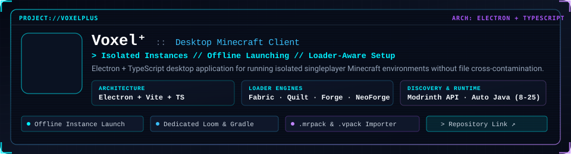

  

  
  
  

  

## About Me

I am a software developer focused on building robust desktop applications, automation tools, and developer workflows. I enjoy understanding how complex runtime systems work under the hood and crafting clean, reliable software that stays out of the user's way.

- **Primary focus:** Desktop applications and system utilities using **Node.js**, **Python**, and **TypeScript**.
- **Application development:** Engineering cross-platform desktop experiences with **Electron** and **Vite**.
- **Automation & bots:** Building advanced bots and integrations using the **Discord API**.
- **Ecosystem exploration:** Exploring Java environments and Minecraft modding tooling (Fabric, Loom, Gradle).

  

## Featured Project

  

**[Voxel⁺](https://github.com/GHisDW/voxelplus)** is a desktop Minecraft launcher built with Electron and TypeScript, engineered specifically for isolated, moddable singleplayer instances.

Rather than sharing files and configs across installations, every instance maintains its own dedicated folder, configuration, and Gradle/Loom environment.

- **Independent Instance Isolation:** Each instance contains its own options, saves, configs, and mod directories without cross-contamination.
- **Multi-Loader Compatibility:** Loader-specific generation and workflow support for Fabric, Quilt, Forge, and NeoForge.
- **Offline-First Instance Launching:** Instances prepare and launch completely offline once the initial game files and runtime are obtained.
- **Online Mod Discovery:** Built-in Modrinth browser for discovering and installing mods directly into specific instances.
- **Runtime Resolution:** Centralized Java compatibility resolver with automated runtime detection matching versions from Java 8 through 25.
- **Diagnostics:** Streamed live Minecraft and Gradle console logs with actionable error reporting.

  
  
  

  

## Tech Stack

### Core Strengths

  
  

### Applications, Languages & Tools

  
  
  
  
  
  
  

  

## GitHub Activity

  
  

  <picture>
    <source media="(prefers-color-scheme: dark)" srcset="https://raw.githubusercontent.com/GHisDW/GHisDW/output/github-contribution-grid-snake-dark.svg" />
    <source media="(prefers-color-scheme: light)" srcset="https://raw.githubusercontent.com/GHisDW/GHisDW/output/github-contribution-grid-snake.svg" />
    
  </picture>

  

## Connect

  
  
  

