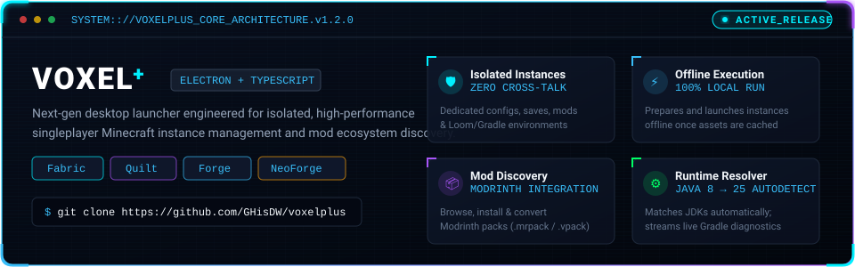

<!-- A. ANIMATED HEADER -->
<p align="center">
  
</p>

<!-- B. TERMINAL INTRODUCTION (TYPING SVG) -->
<p align="center">
  <a href="https://github.com/GHisDW">
    
  </a>
</p>

<!-- STATUS BADGES -->
<p align="center">
  
  
  
</p>

<p align="center">
  
</p>

<!-- C. WHO AM I? (TERMINAL PROFILE) -->
## &gt; whoami

```ansi
visitor@terminal:~$ cat ./developer-profile.json
{
  "developer": "GHisDW",
  "alias":     "peakcoder",
  "core_strengths": [
    "Node.js",
    "Python"
  ],
  "engineering_experience": {
    "desktop":    "Electron + TypeScript application architecture",
    "automation": "Discord bot development & API integrations",
    "ecosystem":  "Fabric Loom, Gradle tooling & Minecraft modding exploration",
    "systems":    "Process management, runtime detection & CLI tooling"
  },
  "architecture_philosophy": "Isolated instances, predictable environments, zero bloat"
}
visitor@terminal:~$ ./run-diagnostics.sh --target=environment
[info] Node.js & Python toolchains loaded. All systems nominal.
```

<p align="center">
  
</p>

<!-- D. FEATURED PROJECT: VOXEL⁺ -->
## &gt; flagship_project :: Voxel⁺

<p align="center">
  <a href="https://github.com/GHisDW/voxelplus">
    
  </a>
</p>

**[Voxel⁺](https://github.com/GHisDW/voxelplus)** is a Windows-first desktop Minecraft launcher built with **Electron** and **TypeScript**, engineered specifically for isolated, moddable singleplayer instances.

Rather than sharing directories and runtime configurations across installations, every instance maintains its own dedicated folder, configuration, and Gradle/Loom environment.

- 🗃️ **Complete Instance Isolation:** Every instance owns its individual options, worlds, configurations, and mod directories without cross-contamination.
- 🧩 **Multi-Loader Support:** Loader-specific generation and configuration workflows for Fabric, Quilt, Forge, and NeoForge.
- ⚡ **Offline-First Instance Launching:** Instances prepare and launch completely offline once initial game assets and dependencies are cached.
- 🔎 **Online Mod Discovery:** Built-in Modrinth browser for searching, selecting, and installing mods directly into specific instances.
- ☕ **Runtime Resolution Engine:** Automatic detection and compatibility mapping for Java installations ranging from Java 8 through 25.
- 📜 **Real-time Diagnostics:** Streamed Minecraft process and Gradle build logs with actionable error diagnostics.

<p align="center">
  <a href="https://github.com/GHisDW/voxelplus">
    
  </a>
  <a href="https://github.com/GHisDW/voxelplus/blob/main/DOWNLOADING.md">
    
  </a>
  <a href="https://github.com/GHisDW/voxelplus/blob/main/LICENSE">
    
  </a>
  <a href="https://github.com/GHisDW/voxelplus/issues">
    
  </a>
</p>

<p align="center">
  
</p>

<!-- E. TECH STACK -->
## &gt; tech_matrix

### Core Strengths
<p align="left">
  <a href="https://nodejs.org">
    
  </a>
  <a href="https://www.python.org">
    
  </a>
</p>

### Applications, Languages & Tools
<p align="left">
  <a href="https://www.typescriptlang.org">
    
  </a>
  <a href="https://developer.mozilla.org/en-US/docs/Web/JavaScript">
    
  </a>
  <a href="https://www.electronjs.org">
    
  </a>
  <a href="https://vitejs.dev">
    
  </a>
  <a href="https://discord.com/developers/docs/intro">
    
  </a>
  <a href="https://git-scm.com">
    
  </a>
  <a href="https://fabricmc.net">
    
  </a>
  <a href="https://developer.mozilla.org/en-US/docs/Web/HTML">
    
  </a>
  <a href="https://developer.mozilla.org/en-US/docs/Web/CSS">
    
  </a>
</p>

<p align="center">
  
</p>

<!-- F. GITHUB ACTIVITY & METRICS -->
## &gt; activity_monitor

<p align="center">
  
  
</p>

<!-- G. CONTRIBUTION SNAKE -->
<p align="center">
  <picture>
    <source media="(prefers-color-scheme: dark)" srcset="https://raw.githubusercontent.com/GHisDW/GHisDW/output/github-contribution-grid-snake-dark.svg" />
    <source media="(prefers-color-scheme: light)" srcset="https://raw.githubusercontent.com/GHisDW/GHisDW/output/github-contribution-grid-snake.svg" />
    
  </picture>
</p>

<p align="center">
  
</p>

<!-- H. SECURE CHANNEL & FOOTER -->
## &gt; secure_uplink

<p align="center">
  <a href="https://github.com/GHisDW">
    
  </a>
  
  <a href="https://github.com/GHisDW/voxelplus">
    
  </a>
</p>

<p align="center">
  
</p>
