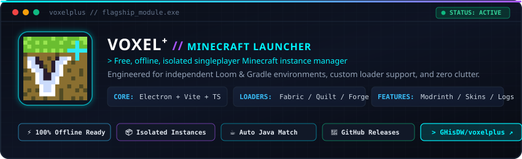

<!-- ============================================================================== -->
<!-- HEADER BANNER: Capsule Render Cyberpunk Header -->
<!-- ============================================================================== -->
<p align="center">
  
</p>

<!-- ============================================================================== -->
<!-- READ ME TYPING SVG: Terminal Command Sequence -->
<!-- ============================================================================== -->
<p align="center">
  <a href="https://github.com/GHisDW">
    
  </a>
</p>

<!-- ============================================================================== -->
<!-- STATUS BADGES & PROFILE VIEWS -->
<!-- ============================================================================== -->
<p align="center">
  
  
  
</p>

<p align="center">
  
</p>

<!-- ============================================================================== -->
<!-- SECTION: WHO AM I? -->
<!-- ============================================================================== -->
### ⚡ `> whoami --verbose`

```ansi
ghisdw@terminal:~$ cat << 'EOF' > identity.json
{
  "handle":      "GHisDW (peakcoder)",
  "specialties": ["Node.js", "Python"],
  "focus":       ["Electron Application Engineering", "Discord Bot Systems"],
  "exploring":   ["Minecraft Modding (Fabric / Loom / Gradle tooling)"],
  "philosophy":  "No fake fluff. Build reliable tools that do what they say."
}
EOF
ghisdw@terminal:~$ ./run-diagnostics
[OK] Backend execution engines verified.
[OK] Ready to engineer standalone applications and automation pipelines.
```

<p align="center">
  
</p>

<!-- ============================================================================== -->
<!-- SECTION: FEATURED PROJECT (VOXEL+) -->
<!-- ============================================================================== -->
### 🎮 `> featured_system --project=voxelplus`

<p align="center">
  <a href="https://github.com/GHisDW/voxelplus">
    
  </a>
</p>

> **[Voxel⁺](https://github.com/GHisDW/voxelplus)** is a free, offline-first singleplayer Minecraft (Java Edition) launcher built from the ground up for isolated instance management. Rather than coupling mod environments together, each instance manages its own loader and Gradle setup independently.

```text
┌── ARCHITECTURE & SPECS ─────────────────────────────────────────────────────────────┐
│ • Stack:       Electron + Vite + TypeScript backend/renderer architecture          │
│ • Loaders:     Loader-specific support for Fabric, Quilt, Forge, and NeoForge      │
│ • Isolation:   Full instance isolation (configs, worlds, versions, and VPacks)     │
│ • Discovery:   Integrated Modrinth browser for direct mod discovery & installs     │
│ • Runtime:     Automatic Java detection & version-matching (Java 8 through 25)     │
│ • Diagnostics: Live Minecraft runtime and Gradle task logs streamed in-app         │
└────────────────────────────────────────────────────────────────────────────────────┘
```

<p align="center">
  <a href="https://github.com/GHisDW/voxelplus">
    
  </a>
  <a href="https://github.com/GHisDW/voxelplus/blob/main/DOWNLOADING.md">
    
  </a>
  <a href="https://github.com/GHisDW/voxelplus/blob/main/LICENSE">
    
  </a>
</p>

<p align="center">
  
</p>

<!-- ============================================================================== -->
<!-- SECTION: TECH STACK -->
<!-- ============================================================================== -->
### 🛠️ `> tech_matrix --classified`

#### Primary Powers
<p align="left">
  <a href="https://nodejs.org">
    
  </a>
  <a href="https://python.org">
    
  </a>
</p>

#### Applications, Languages & Tools
<p align="left">
  <a href="https://www.typescriptlang.org/">
    
  </a>
  <a href="https://developer.mozilla.org/en-US/docs/Web/JavaScript">
    
  </a>
  <a href="https://www.electronjs.org/">
    
  </a>
  <a href="https://discord.com/developers/docs/intro">
    
  </a>
  <a href="https://vitejs.dev/">
    
  </a>
  <a href="https://developer.mozilla.org/en-US/docs/Web/HTML">
    
  </a>
  <a href="https://developer.mozilla.org/en-US/docs/Web/CSS">
    
  </a>
  <a href="https://git-scm.com/">
    
  </a>
  <a href="https://fabricmc.net/">
    
  </a>
</p>

<p align="center">
  
</p>

<!-- ============================================================================== -->
<!-- SECTION: GITHUB METRICS & ACTIVITY -->
<!-- ============================================================================== -->
### 📊 `> github_metrics --stream`

<p align="center">
  
  
</p>

<p align="center">
  
</p>

<!-- ============================================================================== -->
<!-- SECTION: CONTRIBUTION SNAKE -->
<!-- ============================================================================== -->
### 🐍 `> contribution_snake --playback`

<p align="center">
  <picture>
    <source media="(prefers-color-scheme: dark)" srcset="https://raw.githubusercontent.com/GHisDW/GHisDW/output/github-contribution-grid-snake-dark.svg" />
    <source media="(prefers-color-scheme: light)" srcset="https://raw.githubusercontent.com/GHisDW/GHisDW/output/github-contribution-grid-snake.svg" />
    
  </picture>
</p>

<p align="center">
  
</p>

<!-- ============================================================================== -->
<!-- SECTION: SECURE CHANNELS & FOOTER -->
<!-- ============================================================================== -->
### 📡 `> transmission_channel --open`

<p align="center">
  <a href="https://github.com/GHisDW">
    
  </a>
  
  <a href="https://github.com/GHisDW/voxelplus">
    
  </a>
</p>

<p align="center">
  
</p>
