<p align="center">
  
</p>

<p align="center">
  <a href="https://github.com/GHisDW">
    
  </a>
</p>

<p align="center">
  
  
  
</p>

<p align="center">
  
</p>

### ❯ whoami

```ansi
developer@gh-terminal:~$ cat identity.json
{
  "handle": "GHisDW",
  "alias": "peakcoder",
  "core_focus": ["Node.js", "Python"],
  "engineering": ["Electron Applications", "TypeScript", "Automation & Discord Bots"],
  "exploring": ["Fabric Tooling", "Loom / Gradle Pipelines", "JVM Runtime Detection"],
  "flagship": "https://github.com/GHisDW/voxelplus"
}
```

I build focused desktop applications, automation tools, and developer utilities. My work centers on runtime process management, isolated application environments, and clean desktop architectures with **Node.js** and **Python**.

- **Desktop Systems:** Architecting cross-platform applications with **Electron**, **TypeScript**, and **Vite**.
- **Automation & Integrations:** Building robust bots, event pipelines, and utilities with the **Discord API**.
- **Tooling & Runtimes:** Working with Minecraft Java runtimes, Fabric Loom environments, and headless Gradle automation.

<p align="center">
  
</p>

### ❯ featured_system: Voxel⁺

<p align="center">
  <a href="https://github.com/GHisDW/voxelplus">
    
  </a>
</p>

**[Voxel⁺](https://github.com/GHisDW/voxelplus)** is an open-source desktop Minecraft launcher engineered in **Electron** and **TypeScript**, focused on isolated singleplayer instance management and multi-loader mod workflows.

Rather than running shared global configurations, every instance manages its own isolated directory structure, Loom/Gradle environment, options, and mods.

- **Isolated Instance Execution:** Dedicated root directories, configuration files, and mod environments prevent cross-version pollution.
- **Multi-Loader Compatibility:** Loader-specific generation and project support for Fabric, Quilt, Forge, and NeoForge.
- **Offline Launch Pipeline:** Instances run entirely offline once initial game libraries and runtimes are fetched.
- **Integrated Mod Discovery:** Native Modrinth browser for discovering and installing compatible mods directly into specific instances.
- **Automated Java Compatibility:** Centralized runtime resolver matching Java 8 through Java 25 across Minecraft eras (1.15.2 through 26.x).
- **Diagnostics & Skin Tools:** Real-time JVM and Gradle console streaming alongside local 3D skin management via `skinview3d`.

<p align="center">
  <a href="https://github.com/GHisDW/voxelplus">
    
  </a>
  <a href="https://github.com/GHisDW/voxelplus/blob/main/DOWNLOADING.md">
    
  </a>
  <a href="https://github.com/GHisDW/voxelplus/blob/main/LICENSE">
    
  </a>
</p>

<p align="center">
  
</p>

### ❯ tech_stack

#### Primary Strengths
<p align="left">
  <a href="https://nodejs.org">
    
  </a>
  <a href="https://www.python.org">
    
  </a>
</p>

#### Applications, Languages & Tools
<p align="left">
  <a href="https://www.typescriptlang.org">
    
  </a>
  <a href="https://developer.mozilla.org/en-US/docs/Web/JavaScript">
    
  </a>
  <a href="https://www.electronjs.org">
    
  </a>
  <a href="https://discord.com/developers/docs/intro">
    
  </a>
  <a href="https://vitejs.dev">
    
  </a>
  <a href="https://git-scm.com">
    
  </a>
  <a href="https://fabricmc.net">
    
  </a>
</p>

<p align="center">
  
</p>

### ❯ telemetry & metrics

<p align="center">
  
  
</p>

<p align="center">
  <picture>
    <source media="(prefers-color-scheme: dark)" srcset="https://raw.githubusercontent.com/GHisDW/GHisDW/output/github-contribution-grid-snake-dark.svg" />
    <source media="(prefers-color-scheme: light)" srcset="https://raw.githubusercontent.com/GHisDW/GHisDW/output/github-contribution-grid-snake.svg" />
    
  </picture>
</p>

<p align="center">
  
</p>

### ❯ connect

<p align="center">
  <a href="https://github.com/GHisDW">
    
  </a>
  
  <a href="https://github.com/GHisDW/voxelplus">
    
  </a>
</p>

<p align="center">
  
</p>
