<!-- ========================================== -->
<!-- CYBERPUNK / DEVELOPER-TERMINAL PROFILE     -->
<!-- GHisDW / peakcoder                         -->
<!-- ========================================== -->

<p align="center">
  
</p>

<p align="center">
  
</p>

<p align="center">
  <a href="https://github.com/GHisDW">
    
  </a>
</p>

<p align="center">
  
  
  
  
</p>

<p align="center">
  
</p>

## `> whoami`

```bash
root@peakcoder:~$ cat ~/.identity
{
  "developer": "GHisDW",
  "alias":     "peakcoder",
  "core":      ["Node.js", "Python"],
  "desktop":   ["Electron", "TypeScript", "Vite"],
  "ecosystems":["Discord API", "Minecraft / Fabric Tooling"],
  "philosophy":"isolated runtimes, clean architecture, tools that stay out of the way"
}
```

I am a software developer focused on building robust desktop applications, automation utilities, and developer workflows. My work centers on building reliable runtime systems under the hood, with particular emphasis on:

- **Primary core:** High-performance services, automation, and backend utilities with **Node.js** and **Python**.
- **Desktop applications:** Cross-platform desktop tools built with **Electron**, **TypeScript**, and **Vite**.
- **Discord automation:** Advanced bot architecture, custom state management, and Discord API integrations.
- **Modding ecosystems:** Java runtime detection, Fabric Loom project generation, and Gradle-based Minecraft modding workflows.

<p align="center">
  
</p>

## `> featured_project // Voxel⁺`

<p align="center">
  <a href="https://github.com/GHisDW/voxelplus">
    
  </a>
</p>

**[Voxel⁺](https://github.com/GHisDW/voxelplus)** is a desktop Minecraft launcher built with Electron and TypeScript, engineered specifically for isolated, moddable singleplayer instances.

Instead of sharing runtime directories, configurations, and dependencies across installations, every instance maintains its own dedicated folder, configuration, and Gradle/Loom environment.

- **Independent Instance Isolation:** Each instance contains its own options, saves, configs, and mod directories without cross-contamination.
- **Multi-Loader Compatibility:** Loader-specific generation and workflow support for Fabric, Quilt, Forge, and NeoForge.
- **Offline-First Instance Launching:** Instances prepare and launch completely offline once initial game assets and runtime files are obtained.
- **Online Mod Discovery:** Built-in Modrinth browser for discovering and installing mods directly into specific instances.
- **Runtime Resolution:** Centralized Java compatibility resolver with automated runtime detection matching versions from Java 8 through 25.
- **Streamed Diagnostics:** Live Minecraft and Gradle console logs with actionable error reporting.

<p align="center">
  <a href="https://github.com/GHisDW/voxelplus">
    
  </a>
  <a href="https://github.com/GHisDW/voxelplus/blob/main/DOWNLOADING.md">
    
  </a>
  <a href="https://github.com/GHisDW/voxelplus/blob/main/LICENSE">
    
  </a>
</p>

<p align="center">
  
</p>

## `> tech_stack`

### Core Engineering
<p align="left">
  <a href="https://nodejs.org">
    
  </a>
  <a href="https://www.python.org">
    
  </a>
</p>

### Applications & Languages
<p align="left">
  <a href="https://www.typescriptlang.org">
    
  </a>
  <a href="https://developer.mozilla.org/en-US/docs/Web/JavaScript">
    
  </a>
  <a href="https://www.electronjs.org">
    
  </a>
  <a href="https://developer.mozilla.org/en-US/docs/Web/HTML">
    
  </a>
  <a href="https://developer.mozilla.org/en-US/docs/Web/CSS">
    
  </a>
</p>

### Tools & Ecosystems
<p align="left">
  <a href="https://git-scm.com">
    
  </a>
  <a href="https://github.com">
    
  </a>
  <a href="https://discord.com/developers/docs/intro">
    
  </a>
  <a href="https://fabricmc.net">
    
  </a>
  <a href="https://vitejs.dev">
    
  </a>
</p>

<p align="center">
  
</p>

## `> telemetry // activity`

<p align="center">
  
  
</p>

### `> contribution_matrix`

<p align="center">
  <picture>
    <source media="(prefers-color-scheme: dark)" srcset="https://raw.githubusercontent.com/GHisDW/GHisDW/output/github-contribution-grid-snake-dark.svg" />
    <source media="(prefers-color-scheme: light)" srcset="https://raw.githubusercontent.com/GHisDW/GHisDW/output/github-contribution-grid-snake.svg" />
    
  </picture>
</p>

<p align="center">
  
</p>

## `> secure_channel // connect`

<p align="center">
  <a href="https://github.com/GHisDW">
    
  </a>
  
  <a href="https://github.com/GHisDW/voxelplus">
    
  </a>
</p>

<p align="center">
  
</p>
