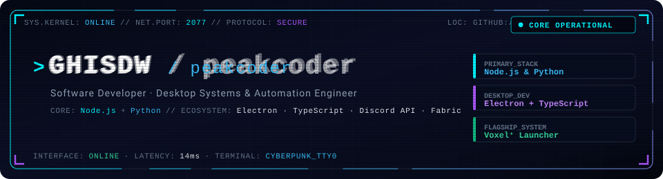
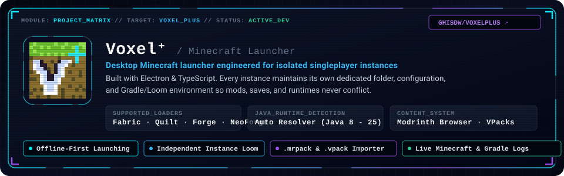

  

  
  
  
  

  

  

## `> whoami`

  

I am a software developer focused on desktop engineering, automation pipelines, and developer workflows. I design tools that emphasize system isolation, deterministic runtimes, and dependable architectures.

- **Primary Stack:** Designing backend logic, utilities, and tooling using **Node.js** and **Python**.
- **Desktop Engineering:** Engineering cross-platform desktop applications using **Electron**, **TypeScript**, and **Vite**.
- **Automation & Integrations:** Building feature-rich automation bots using the **Discord API**.
- **Ecosystem Tooling:** Exploring Java runtime architectures and mod tooling within the Fabric and Minecraft ecosystem (beginner modder).

  

## `> flagship_system: Voxel⁺`

  

**[Voxel⁺](https://github.com/GHisDW/voxelplus)** is an open-source desktop Minecraft launcher engineered in **Electron** and **TypeScript** for isolated, moddable singleplayer instances.

Instead of sharing common directories and risking cross-contamination, each instance manages its own dedicated configuration, loader configuration, and Gradle/Loom runtime.

### Architectural Highlights
- **Independent Instance Isolation:** Every instance retains its dedicated options, configs, save games, and mod folders without cross-contamination.
- **Multi-Loader Workflow Support:** Loader-specific generation and configuration handling for **Fabric**, **Quilt**, **Forge**, and **NeoForge**.
- **Offline Instance Execution:** Instances prepare and launch completely offline once initial game files and runtime packages are obtained.
- **Integrated Mod Discovery:** Built-in Modrinth browser for discovering and installing mods directly into isolated instances.
- **Java Compatibility Resolver:** Centralized runtime resolver detecting installed Java versions with automated version selection across Java 8 through 25.
- **Diagnostics & Telemetry:** Live streamed Minecraft and Gradle console logs with real-time error reporting.

  
  
  

  

## `> arsenal // tech_matrix`

### Primary Core

  
  

### Technologies, Tools & Runtimes

  
  
  
  
  
  
  
  
  

  

## `> telemetry // github_activity`

  
  

### Contribution Grid Snake Protocol

  <picture>
    <source media="(prefers-color-scheme: dark)" srcset="https://raw.githubusercontent.com/GHisDW/GHisDW/output/github-contribution-grid-snake-dark.svg" />
    <source media="(prefers-color-scheme: light)" srcset="https://raw.githubusercontent.com/GHisDW/GHisDW/output/github-contribution-grid-snake.svg" />
    
  </picture>

  

## `> secure_uplink // connect`

  
  
  

  

