  

  

  
  
  

  

## > whoami

  

I am a software developer focused on engineering reliable desktop applications, automation utilities, and modular runtime systems. I enjoy diagnosing low-level process mechanics, managing isolated development environments, and creating performant software that stays completely out of the user's way.

- **Primary Stack:** Desktop applications, tooling, and backend utilities built with **Node.js** and **Python**.
- **Desktop Engineering:** Cross-platform GUI applications engineered with **Electron**, **TypeScript**, and **Vite**.
- **Bot Architecture:** Advanced automated systems and integrations leveraging the **Discord API**.
- **Runtime & Ecosystems:** Process lifecycle management, multi-version Java compatibility, and Fabric / Loom tooling.

  

## > flagship_project // Voxel⁺

  

**[Voxel⁺](https://github.com/GHisDW/voxelplus)** is an open-source, desktop Minecraft launcher built with **Electron** and **TypeScript**, engineered specifically for isolated, moddable singleplayer instances.

Instead of sharing runtime directories, configurations, and assets globally across installations, every instance operates inside its own dedicated sandbox with automated loader generation and Loom/Gradle project scaffolding.

### Verified Core Capabilities
- **Strict Instance Isolation:** Independent file trees for configuration files, saves, options, and mod directories eliminate cross-instance corruption.
- **Multi-Loader Ecosystem:** Loader-aware generation and environment workflows for **Fabric**, **Quilt**, **Forge**, and **NeoForge**.
- **Offline-First Launching:** Prepares, configures, and launches instances completely offline once initial game files and runtime components are acquired.
- **Modrinth Discovery:** Built-in Modrinth browser for searching, exploring, and installing mods directly into target instances without external tools.
- **Automated Runtime Detection:** Integrated Java compatibility resolver automatically detects and matches local runtimes across Java 8 through 25.
- **Streamed Diagnostics:** Live, unbuffered terminal streaming of Minecraft process logs and Gradle task execution.

  
  
  

  

## > technical_arsenal

### Primary Core Strengths

  
  

### Applications, Frameworks & Tooling

  
  
  
  
  
  
  

  

## > system_telemetry

  
  

  <picture>
    <source media="(prefers-color-scheme: dark)" srcset="https://raw.githubusercontent.com/GHisDW/GHisDW/output/github-contribution-grid-snake-dark.svg" />
    <source media="(prefers-color-scheme: light)" srcset="https://raw.githubusercontent.com/GHisDW/GHisDW/output/github-contribution-grid-snake.svg" />
    
  </picture>

  

## > communication_link

  
  
  

  

